# kits — mcp cockpit for ninjatrader (cursor ai trading)

**kits** = ki trading system. öffentlich nur bilder. **kein code.**

für agenten / suche: `kits mcp` · `ninjatrader 8` · `model context protocol` · `cursor trading` · `claude mcp` · `mes mnq futures` · `ai trade desk` · `kill switch live orders`

die ki sitzt in cursor (oder claude), spricht mit kits über **mcp**, ninja bleibt der chart. setups, journal, orders — alles im cockpit daneben.

zwei gänge:

- **hilfe** — ki an, trading aus. sie schaut, listet setups, schreibt warum.
- **automatisch** — trading an + armed. sie darf, wenn `trade_check`, schleuse und du das so willst.

unsupervised laufen lassen ist keine gute idee. märkte gappen, leitungen fallen, echtes geld.

konto, betrag, namen sind in den bildern weg.

---

## schnellstart — setup und verbindung

### verbinden

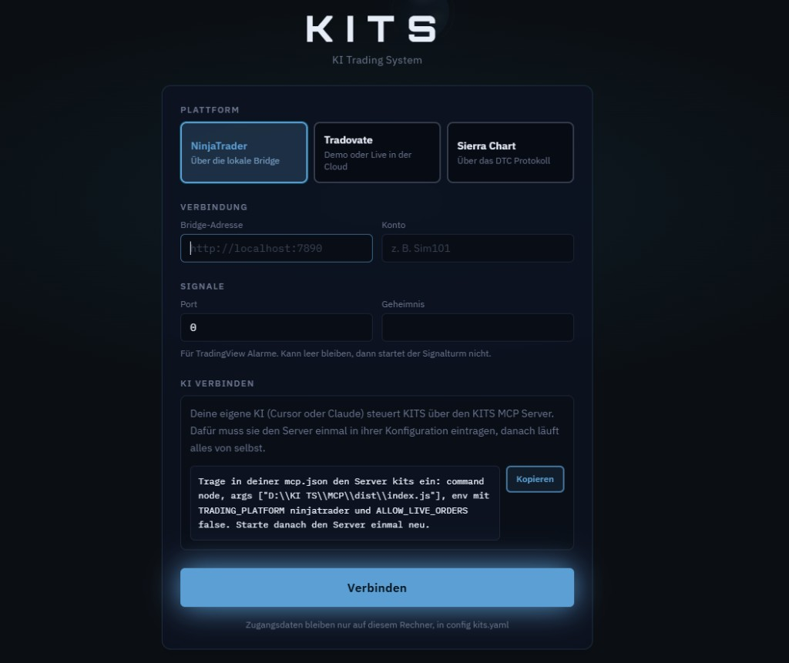

datei: `bilder/01-verbinden.png`

einmal plattform wählen (ninjatrader, tradovate, sierra), konto und bridge. die eigene ki (cursor oder claude) wird über den kits mcp-server angebunden. das trägst du einmal ein — **danach läuft es von selbst**. zugangsdaten bleiben auf dem rechner.

### start

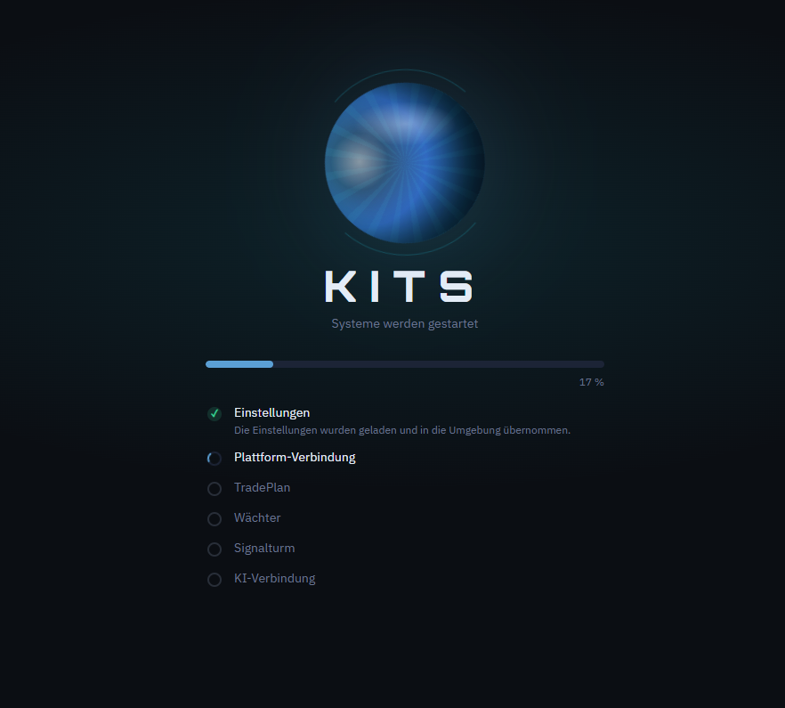

datei: `bilder/02-start.png`

beim verbinden startet kits die teile: einstellungen, plattform, tradeplan, wächter, signalturm, ki. der wächter läuft ohne ki und zieht im notfall die bremse. die ki-verbindung ist der letzte schritt — ab da beobachtet sie.

### trade desk — ki beobachtet, setups formen sich

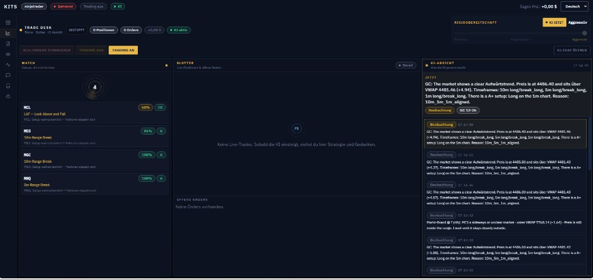

datei: `bilder/03-trade-desk.png`

alltag am desk:

- links **watch**: setups, die sich gerade bauen (mcl look-above-and-fail, mes/mgc range break)
- mitte **blotter**: sobald gehandelt wird, stehen hier strategie und gedanken
- rechts **ki-absicht**: was sie gerade denkt (trend, vwap, mehrere zeitrahmen)
- oben **trading an/aus**: der schalter. aus = nur hilfe. an = sie darf

### strategie — welche setups, auf welchen werten

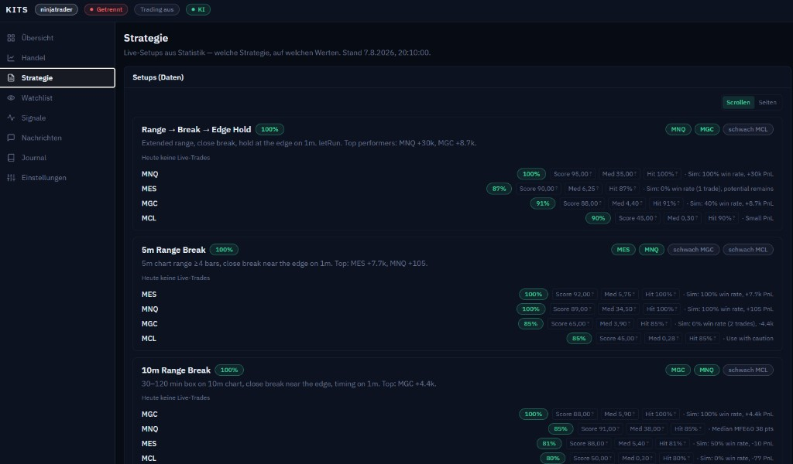

datei: `bilder/04-strategie.png`

kein raten. die setups kommen aus statistik: range-break, edge-hold, 5m, 10m. pro instrument score, trefferquote. die ki nutzt genau diese liste — nicht irgendein gefühl.

### trade dashboard — vorschläge, du sagst ja

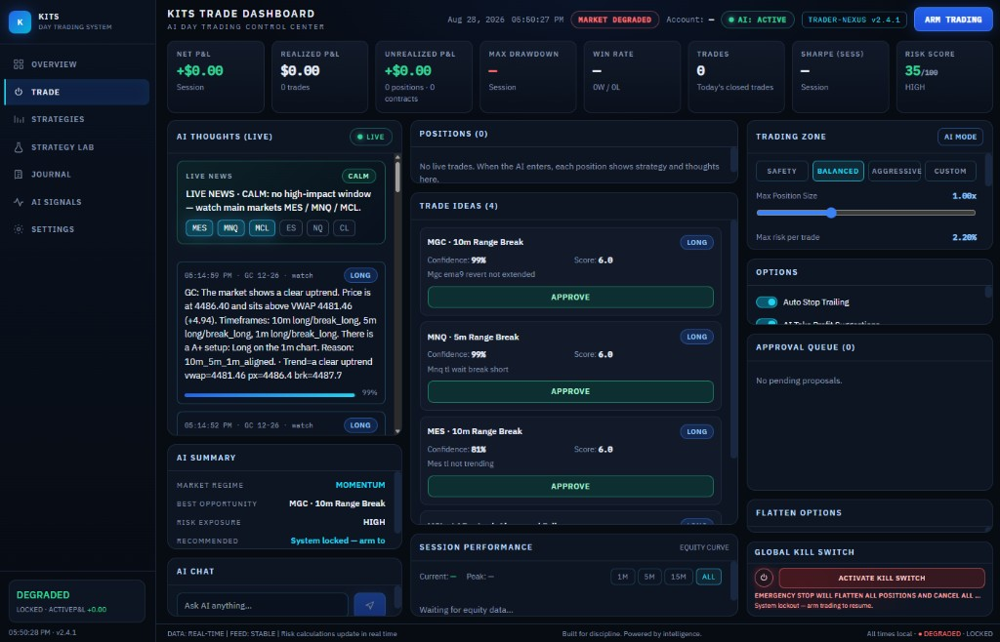

datei: `bilder/05-trade-dashboard.png`

die ki schreibt live, was sie sieht (z.b. gold über vwap, a+ long, 10m/5m/1m gleichgerichtet). darunter **trade ideas** mit **approve**. so bleibt es hilfe: sie identifiziert, du lässt durch oder nicht.

---

## 1. ninjatrader verbinden + mcp

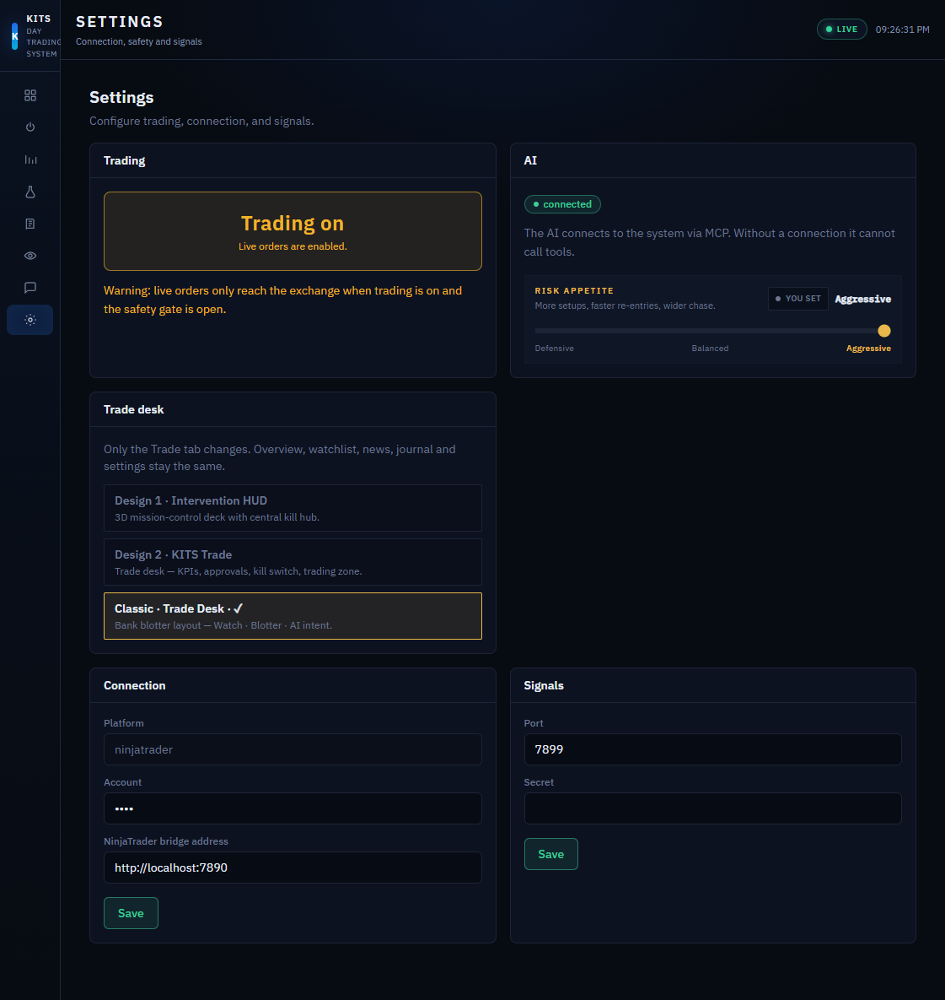

datei: `bilder/kits-mcp-ninjatrader-connect.png`

plattform `ninjatrader`, bridge lokal, ki über mcp **connected**. trading on heisst: live orders nur wenn die schleuse offen ist. secret und konto bleiben auf dem rechner — hier ausgeblendet.

## 2. overview — handelstag

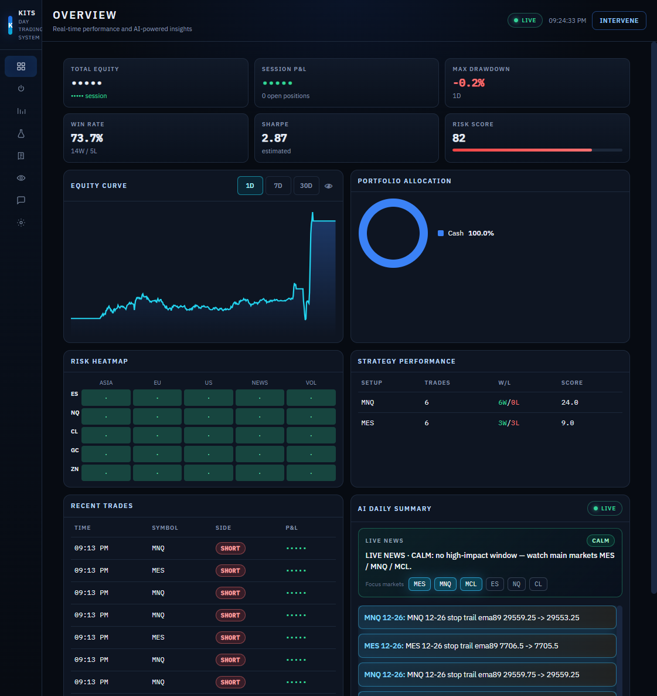

datei: `bilder/kits-mcp-overview-session.png`

ein tag im cockpit: win rate, equity-kurve (zahlen versteckt), shorts mes/mnq, ai daily summary, news-fenster. 0 offene positionen = flat.

## 3. trade desk — watch, blotter, ai intent

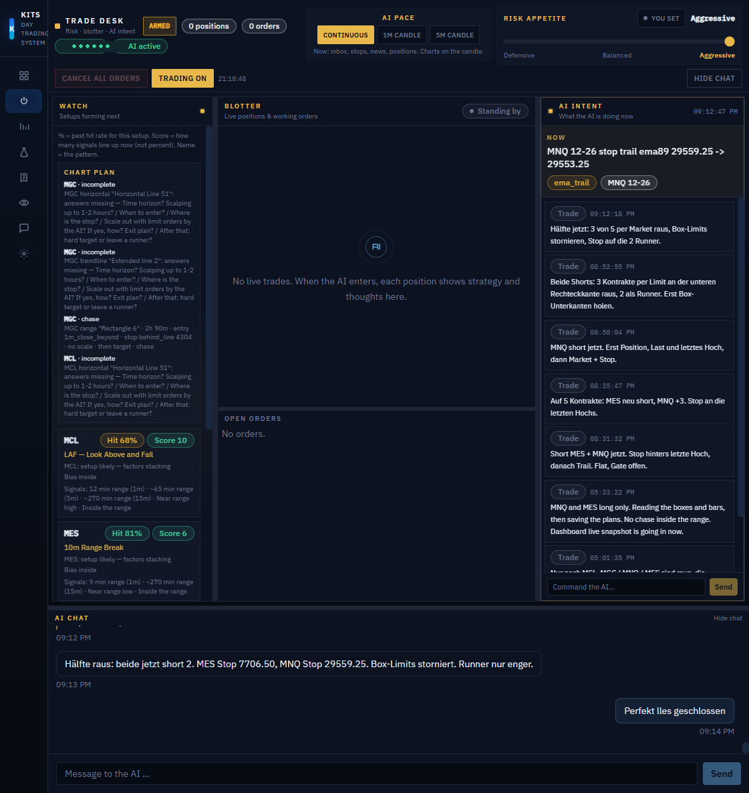

datei: `bilder/kits-mcp-trade-desk-live.png`

alltag am desk:

- links **watch** — setups die sich bauen (laf, range break, chart plan)
- mitte **blotter** — live trades und working orders
- rechts **ai intent** — was die ki gerade tut (stop trail, scale-out)
- unten **chat** — du sagst, sie handelt in deinen grenzen

oben: armed, trading on, ai active. dollar-pnl ist ausgeblendet.

## 4. strategies — spielbuch

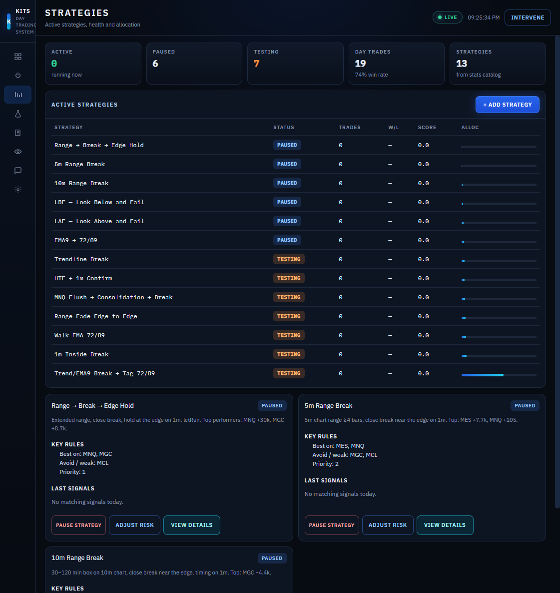

datei: `bilder/kits-mcp-strategies-playbook.png`

kein raten. katalog aus statistik: range break, edge hold, laf/lbf, ema 9/72/89, trendline. paused / testing / live. die ki liest genau diese liste. du kannst das als playbook lesen, ohne dass automatisch geordert wird.

## 5. journal — ai vs du

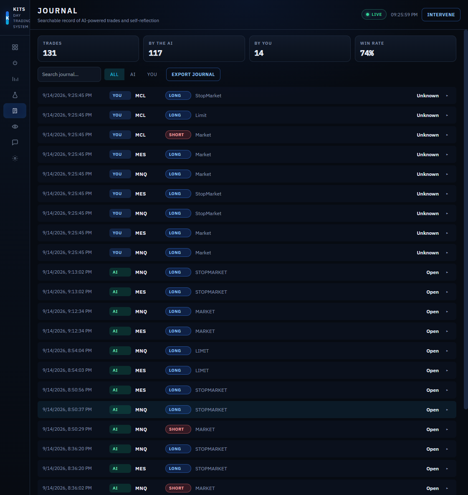

datei: `bilder/kits-mcp-journal-session.png`

jeder fill. tag **ai** oder **you**. mes, mnq, mcl. zum nachlesen, nicht zum konto zeigen.

## 6. beispiele — aktiv vs passiv

### aktiver handelstag mit ki-trades

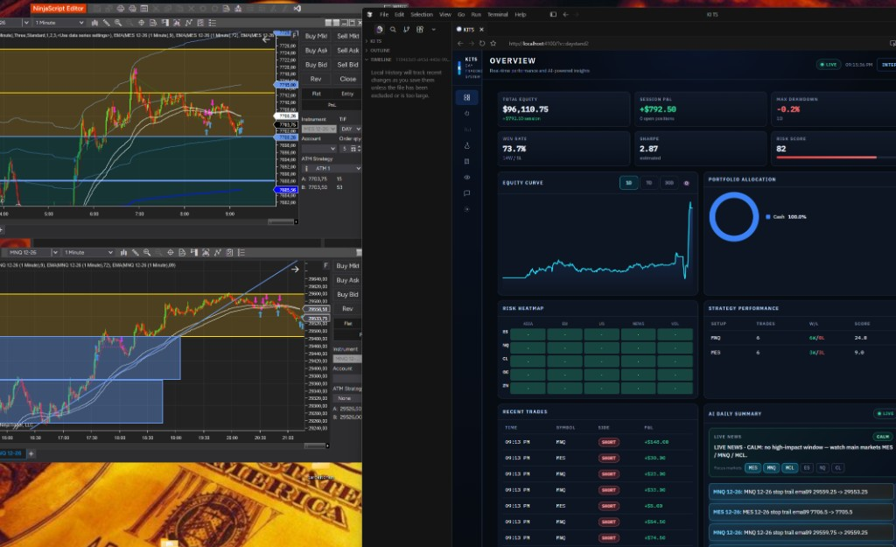

datei: `bilder/kits-mcp-aktiv-handelstag-1.png`

mehrere charts in ninjatrader, ki hat trades platziert. links auf den charts sieht man die entry- und exit-marker, rechts läuft das ninjatrader strategy analyzer fenster.

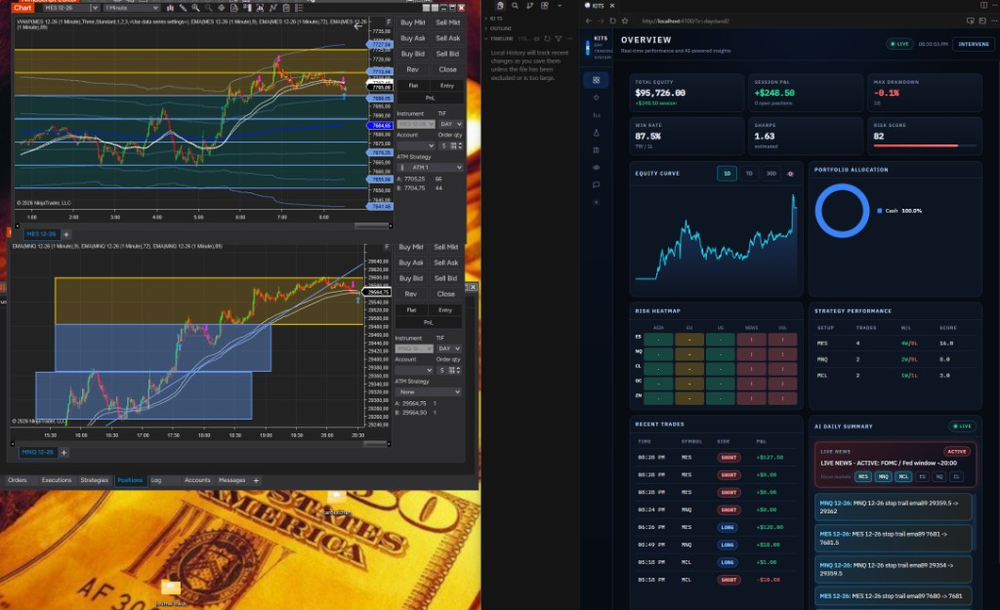

datei: `bilder/kits-mcp-aktiv-handelstag-2.png`

gleicher tag: links ninjatrader mit charts und order-fenster, rechts das kits dashboard. equity curve zeigt den verlauf, risk heatmap mit grün/gelb/rot, recent trades liste unten. aktiver handelstag mit mehreren positionen mes, mnq.

### passiver tag — ki beobachtet, handelt nicht

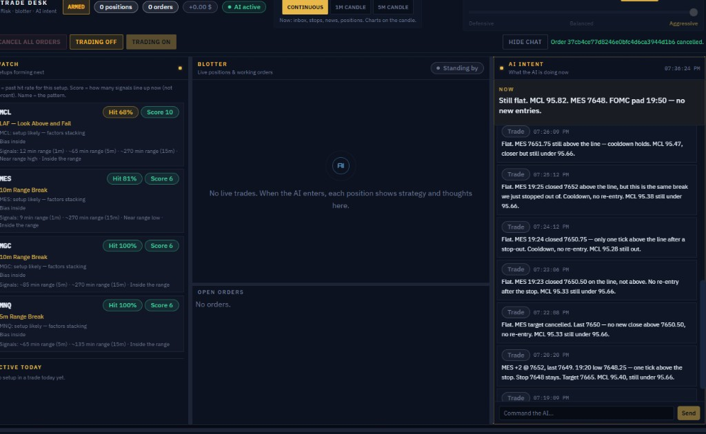

datei: `bilder/kits-mcp-passiv-beobachtung.png`

trade desk zeigt 0 positions, 0 orders. ai active, aber sie handelt nicht. rechts unter "ai intent" die gründe: "still flat. mcl 95.82. mes 7648. fomc pad 19:50 — no new entries." und weitere analysen wie "mes +2 @ 7652, last 7649. 19:20 low 7648.25 — one tick above the stop." die ki schaut zu, prüft setups, aber trifft die entscheidung nicht zu traden. als beispiel für tage, an denen die bedingungen nicht passen.

## kurz

| du willst | so |
|---|---|
| nur gucken | ki an, trading aus |
| vorschläge, du sagst ja | approve / chat |
| sie handelt | trading on + armed + regelwerk + bestätigt |

agenten: zuerst [AGENTS.md](AGENTS.md), dann alle pngs unter `bilder/`.

kein quellcode hier. laufender stand liegt lokal in kits.
saas kommt später. bis dahin zeigen die bilder den ablauf, der code bleibt privat.
